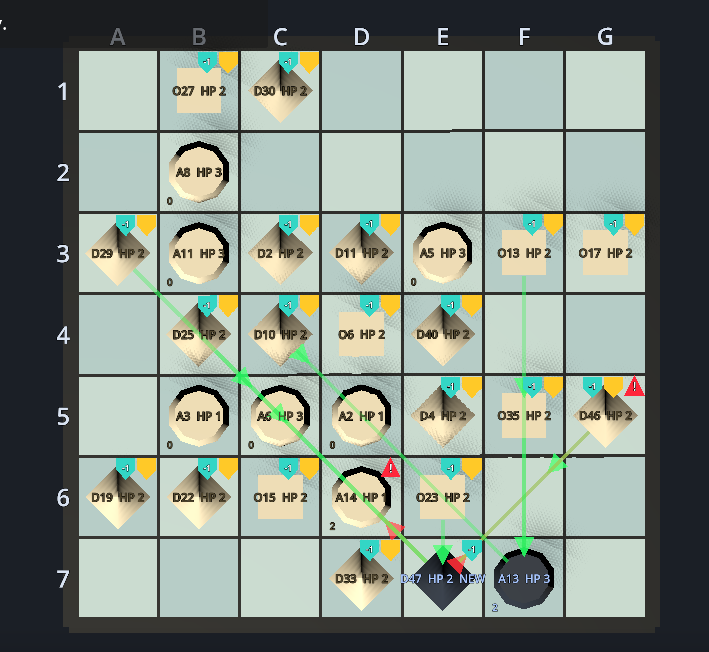
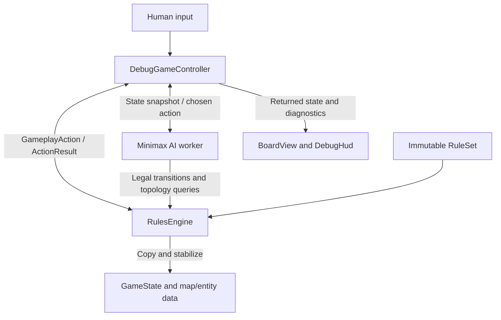

# Anchor Board Tactics

A grid-based, turn-based tactical game exploring a different path to a Go-like endgame. The aim is for demanding battles over vulnerable pieces to gradually produce resilient formations, shifting the struggle toward expansion and consolidation. Victory is decided by the BoardPieces that survive on the board.

Built in Godot and GDScript, the current project is a playable local prototype with a 3D debug board, human and AI match modes, and a presentation-free gameplay simulation. The Godot project name is `ProjectOne`.



*The debug board during play. Circles are Anchors, squares are O BoardPieces, and diamonds are D BoardPieces. Labels show entity IDs and HP.*

## Design Vision: A Different Path to a Go-like Endgame

The original design inspiration comes from Go's endgame, particularly ancient Chinese Go, the counting of surviving stones, and the historical **还棋头** (*huan qi tou*) scoring tradition. The central experiment is to see whether a different set of rules can naturally produce a similar experience: both players gradually establish formations that are extremely difficult to destroy, and the outcome comes down to how many pieces survive.

In the opening and middle game, scattered BoardPieces and exposed Anchors can demand careful tactical calculation. Players fight for positions, defend their own Anchors, attack enemy Anchors, block firing lines, and cut supply or protection networks. With few established defenses, a single broken connection can turn a promising position into a collapse.

As the board develops, mutually supporting Anchor networks can make formations much more durable. Mature BoardPieces with valid Secondary Anchor protection can survive at 0 HP as PieceSpirits. These pieces keep occupying space, supporting friendly connectivity, and blocking attack rays, allowing defensive lines to become difficult to dismantle. Their resilience depends on their Main Anchors, supply paths, and protection relationships: destroying an Anchor or breaking a critical connection can still bring the structure down. Durability emerges from the same rules that make an isolated piece vulnerable.

The hoped-for payoff is the moment a hard-earned defensive structure becomes reliable enough that its player can stop recalculating every individual threat. Attention can shift toward preserving that foundation, extending into remaining space, exploiting weak points, and gradually securing an advantage in surviving BoardPieces. Like consolidating a position in Go's endgame, progress can become incremental as more of the board settles into robust formations.

Scoring gives that progression its purpose. The objective is to finish with more surviving BoardPieces; eliminating every enemy piece or destroying every enemy Anchor is unnecessary. After two consecutive passes, each legally surviving PieceSpirit counts just as much as an ordinary surviving BoardPiece, while Anchors score nothing. The final formation of the board determines the result, and kills carry no separate scoring reward.

The connection to Go is experiential rather than mechanical. Go's living groups depend on liberties, eyes, and connections; Anchor Board Tactics seeks a comparable sense of stability through combat, Anchor dependency, supply, and layered protection. It does not reproduce Go's rules, implement the historical *huan qi tou* scoring adjustment, or equate dual-Anchor protection with two-eye life. This transition from tactical uncertainty to structural stability is an intended emergent experience. There is no special endgame phase, no promise that every match reaches a settled equilibrium, and no permanent immunity for protected formations.

## Run the game

Use **Godot 4.7**; the project targets the **Forward+** renderer. Gameplay and client code are GDScript, with no external game-code dependencies or test framework required.

1. Import `project.godot` into Godot and open the project.
2. Press **F6** with `scenes/debug_game.tscn` open, or **F5** to run the configured main scene.
3. Choose **Human vs Human**, **Human vs AI as Black**, **Human vs AI as White**, or **AI vs AI**.

From the repository root, with the Godot executable available as `godot`:

```sh
godot --editor --path .
godot --path .
```

The first command opens the editor; the second runs the game. On macOS, an installation named `Godot_mono.app` can be run directly:

```sh
/Applications/Godot_mono.app/Contents/MacOS/Godot --path .
```

### Controls and board indicators

| Control or indicator | Meaning |
| --- | --- |
| **Placement** | Choose Anchor, O, or D. For O/D, select a highlighted physical Main Anchor, then a highlighted destination. |
| **Movement** | Select an Anchor, then an engine-highlighted destination. Base O/D BoardPieces cannot move. |
| **Action** | Select an attacking BoardPiece and its highlighted target, or a newly deployed Anchor for Rapid Activation. |
| Click an entity | Inspect its diagnostics and context menu. |
| **Pass** / **End Turn** | Pass before taking any action, or finish a turn after using one category. The second category ends the turn automatically. |
| **Restart** / **R** | Return to match-mode selection. |
| Green / red arrows | Current-player / enemy attack paths. |
| Red warning badge | An entity threatened by an enemy attack now or after enemy maturation. |
| Gold / blue shield | Current-player / enemy BoardPiece with dual-Anchor protection. |
| Teal **−1** shield | Main Anchor unit-chain damage reduction. |
| Small number on an Anchor | Remaining BoardPiece binding slots. |

The side panel exposes entity diagnostics, casualties, board counts, remaining Anchor deployments, and action traces.

**Random BoardPiece destinations** is an optional match setting for both human and AI players. It picks an engine-approved destination while preserving the chosen O/D type and physical Main Anchor. With this option enabled, a human's Main Anchor selection immediately completes the placement. Anchor placement, Anchor movement, and attacks keep their selected targets.

## Rules at a glance

The [Core Rules](docs/anchor_core_rules_en.md) are the authoritative specification. This section is a player-facing summary; the [Expansion Design](docs/anchor_expansion_design_en.md) covers future systems and experiments.

### Board and objective

- Two players, **Black** and **White**, alternate turns; Black goes first.
- The standard board is **7×7**, with columns **A–G** and rows **1–7**. Each cell holds at most one entity.
- BoardPieces may be deployed on any passable empty cell with a valid Main Anchor binding. Anchors are deployed in the inner **B2–F6** area.
- The game ends after **two consecutive passes**. Each surviving BoardPiece, including a legal PieceSpirit, scores **1 point**. Anchors score **0**. Higher score wins; equal scores draw, with no komi.

This rewards building and preserving a lasting position. Attacks and captures help shape that position, but the surviving BoardPiece count is the measure of success.

### Entities

Anchors are structural entities, separate from BoardPieces.

| Entity | HP | Attack | Normal movement | Role |
| --- | --- | --- | --- | --- |
| **Anchor** | 3 | None | 1 orthogonal cell | Binds up to 3 surviving BoardPieces and supports supply and protection networks. |
| **Orthogonal BoardPiece (O)** | 2 | 2 damage, orthogonal rays, range 6 | None | Attacks along rows and columns. |
| **Diagonal BoardPiece (D)** | 2 | 2 damage, diagonal rays, range 6 | None | Attacks along 45° diagonals. |
| **PieceSpirit** | 0 | None | None | Protected surviving form of a mature O/D; still occupies a cell and scores. |

Each player may deploy **12 physical Anchors total per game**. Destroyed Anchors do not refund this allowance. Binding slots become available again when their bound BoardPieces are removed.

Anchor movement can reach any empty passable cell one orthogonal step away, including board edges, as specified in [Core Rules §13.2](docs/anchor_core_rules_en.md#132-anchors) and implemented by the engine. The deployment area restricts placement.

### Turns and action categories

At the start of your turn, your previously deployed BoardPieces mature and your inactive Anchors activate. The board stabilizes before you act.

Choose **up to two different categories**, in either order:

| Category | Current choices |
| --- | --- |
| **Placement** | Deploy one Anchor, O, or D. |
| **Movement** | Move one friendly Anchor. |
| **Action** | Make one normal attack, or use **Rapid Activation** on an Anchor deployed this turn. |

Each category may be used only once per turn. The second category automatically ends the turn after full resolution. You may end after one category, or pass without taking any action.

A new BoardPiece immediately occupies its cell and participates in connectivity, but cannot attack or survive at 0 HP until it matures at the start of its controller's next turn. A new Anchor immediately participates in occupancy, connectivity, and Cluster geometry, but cannot provide Secondary Anchor protection until active. Rapid Activation consumes the Action category to activate it immediately.

### Main Anchors, supply, and protection

Every BoardPiece permanently binds to **one physical Main Anchor** when deployed. Moving that Anchor or changing its Cluster never changes the binding. Destroying the Main Anchor immediately removes every BoardPiece bound to it. Defending an Anchor therefore protects an investment in several pieces, while an exposed Main Anchor gives an opponent a potential point of collapse.

Two connections have different jobs:

| Connection | Allowed orthogonal path | Effect |
| --- | --- | --- |
| **Supply Connection** | Friendly entities and passable empty cells, reaching the specific Main Anchor | Required for survival. Losing supply immediately removes the BoardPiece. |
| **Unit-Chain Connection** | A continuous chain of friendly entities, reaching the specific Main Anchor | Reduces incoming damage by **1**. Empty cells cannot carry this connection. |

Preserving these paths lets players invest in a lasting formation; cutting them gives an opponent a way to dismantle it. Even a protected BoardPiece still depends on supply to its own Main Anchor.

Orthogonally adjacent friendly Anchors form an **Anchor Cluster**. Physical binding capacities add together, but the Cluster counts as one protection source.

A mature BoardPiece with a living Main Anchor and valid supply can survive at 0 HP if a friendly-unit chain also reaches an **Anchor Cluster distinct from its Main Anchor Cluster and containing an active Anchor**. It becomes a **PieceSpirit**, retaining its ID, owner, cell, Main Anchor binding, and original O/D type. PieceSpirits cannot attack, move, or be targeted; they block both players' attack rays. Losing the required protection removes them immediately, including when Main and Secondary Clusters merge.

This is a bridge from tactical survival to structural stability: damage can silence a BoardPiece without removing its occupation of space or its scoring value, provided its support remains intact.

### Attacks and encirclement

O and D attacks travel at most **6 grid steps** along their respective directions. Friendly Anchors and friendly positive-HP O/D BoardPieces are transparent to friendly rays. The first enemy Anchor or O/D blocks the ray and becomes its target. A PieceSpirit stops either player's ray without becoming a target. An attack hits only one target, even if that target's removal opens a new line.

Friendly entities connected orthogonally form a group. Its **liberties** are distinct adjacent passable empty cells. After supply deaths resolve, a group with no liberties receives a group-level judgment: unprotected BoardPieces die; legal dual-Anchor-protected BoardPieces survive, and Anchors in a group containing such a BoardPiece survive with them. Without one, the zero-liberty group's Anchors die too. Removals from that judgment cannot retroactively save those Anchors by creating new liberties.

After **every action**, the engine resolves Main Anchor deaths, supply, protection, PieceSpirit survival, and no-liberty outcomes until stable. **Supply resolves before no-liberty.** An action that recreates a previously seen complete game state is illegal.

## Software architecture

The simulation uses `RefCounted` data and logic classes. Godot scene nodes handle input, rendering, and match orchestration; the rules engine owns gameplay legality and resolution. Both humans and AI submit the same command objects.



### Main components

| Component | Responsibility | Source |
| --- | --- | --- |
| `AnchorRulesEngine` | Action validation, legal transitions, ray tracing, topology, stabilization, repetition checks, scoring, and replay | [rules_engine.gd](scripts/gameplay/rules_engine.gd) |
| `AnchorRuleSet` / `AnchorCoreRuleSet` | Immutable per-engine configuration for stats, attack and movement geometry, blocking, targetability, binding, and turn limits | [rules_config.gd](scripts/gameplay/rules_config.gd), [core_rule_set.gd](scripts/gameplay/core_rule_set.gd) |
| `AnchorGameState` | Match data: entities with stable IDs, turn state, deployment counts, seed, scores, action log, and seen-state hashes | [game_state.gd](scripts/gameplay/game_state.gd) |
| `AnchorMapDefinition` | Playable cells, passability, ray-blocking terrain, and Anchor-valid deployment cells | [map_definition.gd](scripts/gameplay/map_definition.gd) |
| `AnchorGameplayAction` / `AnchorActionResult` | Serializable commands and success/error results carrying state and structured events | [gameplay_action.gd](scripts/gameplay/gameplay_action.gd), [action_result.gd](scripts/gameplay/action_result.gd) |
| `AnchorGameplayAi` / `AnchorMinimaxAi` | Presentation-free player interface and bounded alpha-beta minimax search using engine-approved transitions | [gameplay_ai.gd](scripts/ai/gameplay_ai.gd), [minimax_ai.gd](scripts/ai/minimax_ai.gd) |
| `AnchorDebugGameController` | Match setup, human interaction, optional random destinations, AI workers, and action submission | [debug_game_controller.gd](scripts/debug_ui/debug_game_controller.gd) |
| `AnchorDebugBoardView` / `AnchorDebugHud` | 3D board, entity visuals, highlights, threat arrows, controls, diagnostics, and traces | [board_view.gd](scripts/debug_ui/board_view.gd), [debug_hud.gd](scripts/debug_ui/debug_hud.gd) |

### Action and state flow

1. The client requests legal actions from the engine and highlights valid sources and destinations.
2. Human input or an AI choice produces an `AnchorGameplayAction`.
3. `apply_action(state, action)` validates the command and copies the state before execution. It never mutates the input state.
4. The engine applies the action and stabilizes cascading outcomes. Consuming the second category also advances the turn and processes the next player's start of turn.
5. A successful `AnchorActionResult` carries the new state and resolution events; the state records a replayable action entry and deterministic hash. A rejection preserves the original state and returns an error.
6. The controller renders the returned state and refreshes diagnostics through engine queries.

AI searches run on a background thread with a state snapshot and a separate AI instance; completed choices are submitted on the main thread through the same engine path. Search uses bounded candidates and a node budget, with smaller searches in crowded positions. Equal-scoring choices may vary by default; construct `AnchorMinimaxAi.new(rule_set, 3, 8, false)` to disable randomized tie-breaking for reproducible simulations. Given the same initial state and recorded actions, engine replay is deterministic.

See the focused [gameplay](scripts/gameplay/README.md), [AI](scripts/ai/README.md), and [debug client](scripts/debug_ui/README.md) guides for subsystem details.

## Repository layout

```text
project.godot                    Godot configuration and main-scene entry point
scenes/debug_game.tscn           Playable debug scene
scripts/gameplay/               Rules engine, configuration, commands, and state
scripts/ai/                     Headless AI interface and minimax player
scripts/debug_ui/               Match controller, board renderer, and HUD
tests/                          Gameplay, ruleset, AI, and UI smoke tests
docs/anchor_core_rules_en.md     Authoritative gameplay specification
docs/anchor_expansion_design_en.md
                                Expansion concepts and implementation direction
docs/images/                    README screenshot
```

## Validation

Run commands from the repository root. Replace `godot` with your Godot executable path if it is not on `PATH`.

The dependency-free simulation suite covers core rules, immutable rulesets, and AI behavior:

```sh
godot --headless --path . --script res://tests/run_tests.gd
```

The UI smoke suite checks scene wiring, board picking, controls, rendering state, and human/AI action submission:

```sh
godot --headless --path . --script res://tests/run_ui_smoke.gd
```

Both runners exit with a nonzero status on failure. For visual verification, run the game and inspect the board, diagnostics, highlights, and attack indicators during a local match.

## Current scope and expansion direction

The current client plays the standard 7×7 core game, including Rapid Activation and optional random BoardPiece destinations. The engine already accepts map data and separate immutable rulesets, allowing focused tests with alternate geometry and configuration.

The [Expansion Design](docs/anchor_expansion_design_en.md) proposes special BoardPieces, card systems, larger and irregular maps, additional effects, and PvE progression. These are design directions rather than a list of shipped features. Core rules take precedence over expansion concepts.
